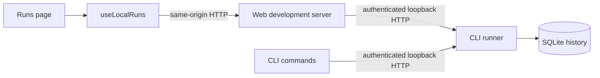

# Kipivo architecture

Applications assemble their runtime behavior. Shared workspaces expose explicit source or configuration subpaths, and implementation details stay in their owning app.

## Code ownership

| Owner            | Responsibility                                                                                                                                                                                               |
| ---------------- | ------------------------------------------------------------------------------------------------------------------------------------------------------------------------------------------------------------ |
| Applications     | Web owns SSR, routes, and browser features. API creates runtime resources and injects services into route groups. CLI owns local execution and SQLite history. Mobile owns its Expo screens.                 |
| Web features     | Start a feature under `apps/web/src/features/<feature>/`. Route files register handlers and enforce access. Views render state and send user intent through a hook.                                          |
| Shared packages  | Consumers import the public entries in the owning package's `exports`. Extract platform-independent rules when another app needs them. Add model, client, or server entries only for concrete callers.       |
| UI and Storybook | `@kipivo/ui` owns DOM primitives and semantic tokens. Web features own product layouts. Storybook demonstrates component states and interactions. Expo renders native controls and can consume shared rules. |

The root Bun catalog pins Zod, Vite, and Vitest for the workspaces that use them. Each consumer declares `catalog:` in its own manifest so Turbo and the CI planner can follow the dependency graph.

## Workspace exports

Auth, Cache, DB, and Storage use the same server-side entry points.

| Import path             | Source           | Purpose                                       |
| ----------------------- | ---------------- | --------------------------------------------- |
| `@kipivo/<pkg>`         | `src/index.ts`   | Shared instance configured by the environment |
| `@kipivo/<pkg>/factory` | `src/factory.ts` | Factory with explicit configuration           |
| `@kipivo/<pkg>/env`     | `src/env.ts`     | Presets and configuration parsing             |

Application entry points use the explicit factories to manage their resources. Other subpaths describe their own contracts, such as DB schema and migrations, the public API client, logger adapters, and UI components and styles.

Runtime packages declare Zod presets in their own `src/env.ts` and name them after the package. The API composes `dbEnv`, `authEnv`, `cacheEnv`, and `storageEnv` with `extends`. It checks that the database and authentication settings are configured together before running startup migrations. Logger settings live in `@kipivo/logger`; server-side local runner credentials and environment settings live in `@kipivo/runtime`, while `@kipivo/contracts/runs` contains shared run schemas. Web declares its upstream API origin in the server-only `src/env.server.ts`.

Application entry points call `createEnv(preset)` from `@kipivo/env` to read values at runtime. Tests can supply an explicit environment. Presets listed later override earlier ones, and a preset's own `server` declarations take precedence.

## Web and public API

Web is a TanStack Start SSR application. The public API is a separate Hono application. Nitro connects the Hono entry to Vite development and builds its Bun production server. Hono owns `GET /healthz`. oRPC serves the same procedures at `/rpc` and as REST endpoints under `/api/v1`.

Web server-renders the public home page on each request and inlines its CSS. Fonts are self-hosted, use `font-display: swap`, and receive immutable caching through fingerprinted asset URLs. The heading's fallback font matches Geist's vertical metrics. Font subsets load only when their characters are needed.

Cloudflare Web Analytics uses **Enable with JS Snippet installation** in the site's RUM settings. The root document owns a `CloudflareAnalytics` component that renders an async module script after the window's `load` event during browser idle time, with a timeout for busy browsers and a timer fallback. React deduplicates the script by its `src`, and Cloudflare's automatic injection stays disabled. To enable analytics for a production build, set `VITE_CLOUDFLARE_ANALYTICS_TOKEN` at Web build time. Web parses this optional value with `@kipivo/env` in `src/env.ts`. For Docker, pass `--build-arg VITE_CLOUDFLARE_ANALYTICS_TOKEN`. For Railway, set the variable on the `web` service. Builds with an empty or missing token skip the script. Visits that end before the script starts may not be recorded.

The optional Umami Cloud trial sends production homepage pageviews for `/` with the referrer reduced to its origin. The home route loads the tracker after hydration and sends pageviews explicitly so client-side navigation to other pages generates no Umami traffic. Set `VITE_UMAMI_WEBSITE_ID` at Web build time to enable it. The Railway `web` service declares the trial site ID. For Docker, pass `--build-arg VITE_UMAMI_WEBSITE_ID`. An empty or missing ID skips the tracker.

The API's `src/server.ts` entry point reads the environment and validates Auth, Redis, and S3 configuration. It runs migrations when `DB_MIGRATE_ON_START=true`, then starts the runtime clients. In development, Vite waits for the Nitro worker to finish loading the entry point before opening the port. Runtime initialization releases already-created clients if a later factory or Hono route registration fails. Only a fully initialized runtime exposes `fetch`; Nitro owns its shutdown, not individual requests.

The public contract lives in `@kipivo/api/contract`. Callers can use the typed client from `@kipivo/api/client` or generate a REST client from `/api/openapi.json`. The API health and ping responses work independently of the local runner. See the [public API guide](api.md).

Web and API each prune and build their own workspace dependencies from the repository root. Railway deploys them as separate services with independent app-specific watch paths. Changes to shared build inputs may deploy both.

A separate Caddy gateway image lives in `.railway/gateway/`. It forwards `/rpc`, `/api/auth`, and `/api/v1` with their descendants and the exact `/api/openapi.json` and `/readyz` paths to `API_UPSTREAM`. Other requests reach `WEB_UPSTREAM`, including Web’s `/healthz`. Production `/api/local` routes return `404` at the gateway. `/gateway-healthz` checks the gateway itself. Railway terminates external TLS, and the gateway forwards `X-Forwarded-Proto: https` while preserving request cookies, Origin, and upstream response headers. Optional `LEGACY_API_HOST` routes requests for an existing API hostname to the API.

The gateway is deployed independently. Public domains continue to use their existing services until a separate domain configuration change is requested; adding the gateway service does not change those bindings.

## Database and authentication

`@kipivo/db` owns PostgreSQL access, the Drizzle schema, and versioned migrations. `@kipivo/auth/factory` configures Better Auth against that database. The API exposes the auth handler at `/api/auth/*`. Its `/readyz` endpoint checks the authentication tables and the account role column.

Web forwards same-origin auth, RPC, REST, and OpenAPI requests to the API. This lets the browser use host-only session cookies on the Web domain. The Hono adapter in `routes/procedures.ts` supplies request headers, request ID, and logger to both transports. The contract implementation in `procedures.ts` receives that context without depending on Hono. An oRPC middleware resolves the signed-in actor from Better Auth for protected procedures only. For procedures declared as trusted writes, that same middleware also requires the configured Web origin. It does not cache role permissions or setup availability. See the [route access matrix](api.md#route-access).

`createDatabase` binds the accounts and setup repositories to the same pool. During API startup, `runtime.ts` injects `database.repositories.accounts` into `@kipivo/core/access` and connects the setup repository to Better Auth’s password hasher for one-time installation. The [Hono adapter](../apps/api/src/context.ts) registers the runtime’s `AppServices` instance in each request’s `@hono/tsyringe` scope. The [runtime](../apps/api/src/runtime.ts) owns the clients and closes them at shutdown. Core implements the current-account, directory, and role-change use cases against that repository interface; it does not create a database connection. `@kipivo/account` supplies the shared profile and personal settings schemas, `@kipivo/admin/directory` defines directory inputs and instance settings, and `@kipivo/rbac` defines the role permissions and the rule for assigning another account's role.

Web applies the assignment rule to the permissions returned by the API to decide whether to show the role-change action. That decision is advisory. Core reads the actor's current role for each operation. Before writing a role, the repository locks the actor and target in a consistent order and applies the same assignment rule with the locked actor's permissions. This ensures a concurrent demotion cannot leave a stale grant in effect. See the [database and authentication guide](auth.md).

The home, sign-in and application routes check `setup.status` in TanStack Router `beforeLoad`, before rendering. `/setup` uses the inverse guard. The API may cache only the terminal `closed` state in instance-scoped Redis for 60 seconds. A miss or Redis failure falls back to PostgreSQL; readiness, registration and the installation transaction never trust this cache. If the API is unavailable the public site remains accessible, but the installer does not show a form. Its account menu loads the current account in the browser through the typed RPC client after hydration. The account directory loads only after the current permissions are available, and the server rechecks authorization for each directory read and role change.

## Application settings

`config_key` is the migration-managed allowlist. Each entry declares its key, scope, editor and optional JSONB default. A composite foreign key enforces the catalog key and scope for every stored override. The API exposes typed operations for individual editable settings rather than arbitrary keys or a JSON editor.

| Key                 | Scope / editor           | Where it is used                                                                                                                                                         |
| ------------------- | ------------------------ | ------------------------------------------------------------------------------------------------------------------------------------------------------------------------ |
| `account_display`   | User / owner             | `/settings`: show name or email in the account menu. Overrides in `config_user` are keyed by session user ID and setting key; deleting the account removes its settings. |
| `account_directory` | Instance / administrator | `/settings`: default account directory page size. Requires `settings.manage`, including a role check inside the write transaction.                                       |
| `email_delivery`    | Instance / administrator | `/settings`: enable email delivery, set the sender, or rotate the encrypted Resend key. Reads return the sender, enabled state, and whether a key is present.            |
| `admin_setup`       | Instance / system        | The setup workflow alone manages the JSONB state; there is no settings API for its value.                                                                                |

Instance overrides are stored in `config_app`. Editable settings use the catalog default until an override exists. To add a setting, seed its definition in a [Drizzle migration](auth.md#schema-changes), define the JSON shape, and bind it to the authorized operation. The API reads database connection details and `BETTER_AUTH_SECRET` from the deployment environment.

## Local runner

On macOS or Linux, open two terminals at the root of a trusted Kipivo checkout with its dependencies installed. In the first terminal, start the runner and leave it running.

```sh
bun run kipivo serve
```

In the second terminal, save the run ID and use it to read the status and logs.

```sh
id=$(bun run kipivo run check)
bun run kipivo status "$id"
bun run kipivo logs "$id"
```

To submit or inspect checks in a browser, start `bun run --cwd apps/web dev` with the runner active and open [Local runs](http://localhost:3000/runs).

The runner binds to `127.0.0.1:4310` by default and runs the checkout's fixed `bun run check` script. It accepts one active check, with a five-minute timeout and a 256 KiB log limit per run. SQLite history lives in `~/.kipivo`. Use a separate private `KIPIVO_HOME` to isolate history.

Web's development-only proxy reads a local runner credential server-side. Browser submissions must come from the same origin. The production Web application returns `404` for the local task page and its API. An interrupted check becomes a failed history entry after restart.

The Runs page renders history, details, and logs. Its `useLocalRuns` hook submits checks, selects runs, and polls the same-origin proxy. Both the browser and CLI use schemas from `@kipivo/contracts/runs`. Only the CLI and the Web server proxy use `@kipivo/runtime/local/connection`, which reads the port and credential from `runner.json`.


