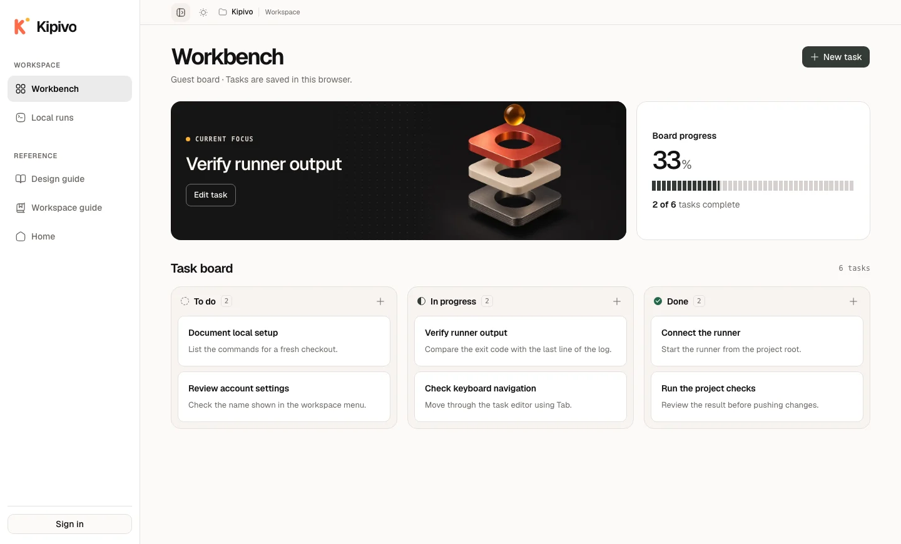

# Kipivo 界面设计规范

从仓库根目录运行 `bun run --cwd apps/web dev`。在[工作台](http://localhost:3000/workbench)创建和编辑任务，访客和登录账号各自在当前浏览器保存自己的看板。本地开发时，启动 runner 后可在[本地运行](http://localhost:3000/runs)发起检查并查看日志。[视觉规范](http://localhost:3000/design-guide)展示控制台的色板、字阶和交互规则。

工作台使用 Kipivo 的 K 标、Geist 和共享主题。焦点卡展示当前任务，旁边显示完成度，任务按阶段排列。将任务状态改为 Done 后，完成计数和进度条会同步更新。

运行记录的日志下方有一张运行路线图。切换记录时，光点从请求走向本地 runner；检查结束后，路线延伸到该次记录的退出码。点 Replay 可以重播。首页、设计指南和认证页的品牌装配图自动展开一次。系统启用减少动态效果时，两张图均显示静态画面。

## 品牌与主题

- 使用仓库的 K 标原图，保持珊瑚色笔画和右上琥珀圆点的比例。与 Kipivo 并排出现时使用 `Wordmark`，由文字提供可访问名称。
- 每个页面最多选一处品牌主视觉。首页可以放在介绍区，工作台放在当前焦点卡。[焦点卡配图](../../apps/web/src/features/workbench/assembly.webp)以哑光材质、深色底和琥珀色圆点呼应装配插画。日志、表格和编辑表单保留纯色阅读面。
- 完成度来自已完成任务数除以总任务数。桌面显示 40 px 的百分比和完成计数。手机用一行展示完成计数和进度条，空看板展示首个任务的创建提示，添加任务后才展示完成度。静态配图属于装饰，使用空的替代文本。

### 颜色按用途选取

| 用途         | 用色                                             | 使用位置                                                           |
| ------------ | ------------------------------------------------ | ------------------------------------------------------------------ |
| 品牌标志     | Coral `#FF6B4A`、Amber `#FFB02E`                 | K 标与配图。品牌源色在两种主题下保持一致                           |
| 页面与内容   | `background`、`card`、`foreground`               | 暖白或炭黑页面，独立内容面和主要文字                               |
| 辅助内容     | `muted`、`muted-foreground`                      | 派生列底、时间、说明和次要导航                                     |
| 主要操作     | `primary`、`primary-foreground`、`primary-hover` | 新建、保存用实心主按钮，取消用描边，列内加号用透明底               |
| 边界         | `border`、`input`、`ring`                        | 分隔线、可输入边界、键盘焦点分别取色                               |
| 失败与删除   | `destructive`                                    | 字段错误、失败的运行结果、删除和确认删除                           |
| 成功反馈     | 控制台色 `--color-workspace-success`             | 浅色 `#236649`、深色 `#89D1AD`。用于 Done 的勾号与 Passed 的状态点 |
| 固定深色面板 | 控制台色 `--color-plate`、`--color-on-plate`     | 焦点卡与日志区使用 `#151516` 和 `#FFFAF4`，两种主题下保持稳定      |

工作区页面及其编辑弹层共用操作色。浅色主题使用墨灰底 `#343A36` 配暖白字 `#FAF9F5`，悬停时加深至 `#282E2A`。深色主题使用暖灰底 `#D6D1C7` 配墨字 `#242722`，悬停时提亮至 `#E5E0D6`。导航选中态使用淡灰底，进度条通过明暗区分已完成部分。

表中共享变量在 CSS 中带 `--` 前缀，在 Tailwind 中使用 `bg-card`、`text-foreground` 等语义类。Web 的默认外观为深色，选择器支持 Light、Dark、System，弹层与页面共享主题。

正文与底色的对比度目标为 4.5∶1，可操作边界和焦点指示为 3∶1。可在 **Design guide** 查看控制台色板，在 Storybook 的 **Foundations → Theme** 查看共享主题基线。[共享色值](../../packages/ui/src/styles/globals.css) · [现有对比度记录](../../packages/ui/README.md#contrast-constraints)

## 字体与布局

| 层级             | 字号 / 行高                   | 用法                                                                  |
| ---------------- | ----------------------------- | --------------------------------------------------------------------- |
| 工作页标题       | 28–36 px / 1.07，650 字重     | 每页一个 h1。工作台标题与 New task 同排，下方说明任务保存在当前浏览器 |
| 当前任务         | 22–30 px / 1.08，555 字重     | 焦点卡和任务卡标题最多两行，编辑器显示完整标题                        |
| 区块标题         | 20 / 26 px，620 字重          | 看板、历史记录、日志输出                                              |
| 任务名、表单标签 | 14 / 21 px，约 600 字重       | 一行写清对象或动作，详细说明独立成段                                  |
| 正文、任务备注   | 14 / 21 px、13 / 20 px        | 备注在卡片里最多两行，编辑器展示完整内容                              |
| 标识与日志       | 12–13 px 等宽，日志行高 21 px | ID、时间、命令、原始输出。百分比使用等宽数字                          |

拉丁文字沿用自托管 Geist，中文回退到苹方、微软雅黑和系统字体。工作页使用紧凑标题，首页展示标题沿用 `PageTitle scale="display"`。中文长文使用自然字距。

顶栏与正文共用水平内边距。桌面的侧栏开关、手机的工作区名称分别与页面标题左对齐。页面标题下方桌面留 24 px、手机留 16 px。工作台摘要与任务看板之间桌面留 32 px、手机留 20 px。内容面板内边距从手机的 16 px 增至桌面的 24 px。导航和操作按钮用 8 px 圆角，任务卡与运行记录用 10 px，外层面板用 16 px。

窗口窄于 768 px 时，导航移到底部。在设计指南页，底部的 More 保持选中，菜单用勾号标出当前页面。内容分栏根据扣除侧栏和内边距后的正文宽度切换。

| 正文可用宽度 | 工作台和运行记录                                                               |
| ------------ | ------------------------------------------------------------------------------ |
| 大于 44 rem  | 看板按三个阶段并排。运行历史与输出按 1 : 2.1 分配空间，历史面板至少宽 17.5 rem |
| 34–44 rem    | 阶段和运行面板纵向排列，焦点卡与完成度并排                                     |
| 至多 34 rem  | 完成度收成焦点卡下方的一行。宽度至多 29 rem 时，每个阶段的任务卡也变为单列     |

运行历史列表宽度小于 28 rem 时，第一行显示名称和状态，第二行显示短 ID 和 UTC 时间。列表宽度达到 28 rem 时，四项排成一行。色板按面板宽度排成六列、三列或两列。图片与路线图按容器等比缩放。

## 组件与交互状态

桌面顶栏的侧栏按钮可在完整导航与 4 rem 图标栏之间切换。手动切换时，侧栏宽度与正文位置在 200 ms 内同步过渡，文字用 120 ms 淡入淡出。刷新恢复偏好或开启「减少动态效果」时直接显示目标布局。折叠偏好由 Zustand 保存在当前浏览器，切换工作区页面后继续生效。手机使用底部导航。

桌面侧栏宽 184–224 px。工作区顶栏从左到右依次显示侧栏开关、主题图标和工作区名称。点击月亮切到深色，点击太阳切到浅色。跟随系统时，第一次点击会切到与当前外观相反的主题，并保存该选择。侧栏底部的账户按钮展示头像和显示名称，点击向上展开菜单。手机在顶栏并排显示主题图标和头像，触控区域至少为 44 × 44 px。登录后可从账户菜单进入 Settings，选择展示名称或邮箱。

工作台标题旁的 New task 在桌面端高 36 px，水平内边距 12 px，字号 14 px。触屏上按钮至少高 44 px，水平内边距 16 px。首页的 Open workbench 是首屏入口，沿用 44 px 高度。

深色焦点卡的编辑按钮和日志区的重播按钮使用相同的亮色键盘焦点环。

| 情境             | 视觉与行为                                                                                                                                |
| ---------------- | ----------------------------------------------------------------------------------------------------------------------------------------- |
| 普通、悬停、选中 | 主按钮悬停使用 `primary-hover`，卡片悬停加深边界。当前导航同时改变底色、字重并提供 `aria-current`                                         |
| 键盘与触屏       | 使用共享 `control-focus` 的 2 px 焦点环；固定深色背景使用亮色环。图标按钮提供动作名称，触屏目标至少 44 × 44 px                            |
| 新建与编辑       | 列上的加号在本列快速创建任务，展开后变为关闭按钮。桌面用右侧编辑面板，手机用居中弹窗。Esc 可关闭；原卡片移列或删除后，把焦点交给 New task |
| 提交中           | 按钮保留宽度，用动词进行式说明操作，设置 `disabled` 与 `aria-busy`。保存成功在操作附近反馈                                                |
| 空状态           | 首次进入提供 New task 和按列快速添加的入口。连接 runner 前显示启动命令，连上后显示首次检查入口。全部完成时焦点卡显示 All caught up        |
| 错误与危险操作   | 字段旁显示可执行的修正提示，并与输入关联。存储或网络错误保留输入。删除说明对象和后果，再次确认执行                                        |
| 动效             | 颜色与面板反馈采用短过渡。减少动态效果时即时换态；底部栏和弹层尊重系统安全区与可见高度                                                    |

**状态编码**　To do 用虚线空圈，In progress 用随主题反转的中性半圆，Done 用带勾实心圆。运行记录用虚线圈表示 Queued，半圆表示 Running，实心圆表示 Passed，菱形表示 Failed。排队或运行中尚无退出码时显示 Pending。需要检查失败原因时，退出码与原始日志出现在同一面板。

## 应用到项目其他页面

| 页面                 | 主要动作与布局                                                                                                           |
| -------------------- | ------------------------------------------------------------------------------------------------------------------------ |
| 首页                 | 使用现有 K 标与装配插画。首屏突出 Open workbench，示例运行和快速开始沿主内容边线排列                                     |
| 登录与安装           | 使用全屏布局和限宽表单，主题切换位于右上角。登录和注册页按可用宽度展示品牌插图。每个输入都有可见标签                     |
| 设置与管理           | 使用 `OperationPage`。设置按表单分组独立保存；账号目录把查询放在列表上方，角色变更在对应账号处发起                       |
| Web 工作台与本地运行 | 工作台按任务阶段分列并展示完成度。本地运行按连接状态展示启动命令、检查入口或运行历史与日志                               |
| Expo 连接页          | 使用原生字体缩放和触控组件。将连接地址、连接检查结果和 Open workspace 依次呈现；需要统一配色时，将上述角色映射到原生主题 |

Web 组件从 `@kipivo/ui` 导入。页面构图和配图归所属功能；某个新语义角色有第二个真实使用场景时，再提升为共享 token。[UI 组件用法](../../packages/ui/README.md) · [Tailwind 主题](../../apps/web/src/styles/globals.css) · [主题切换动效](../../apps/web/src/styles/theme-transition.css) · [工作区路由](../../apps/web/src/routes/_app/) · [原生主题](../../apps/mobile/src/components/theme.ts)
